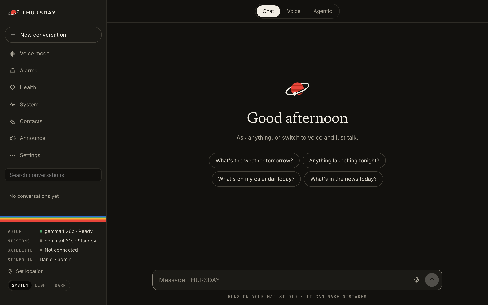
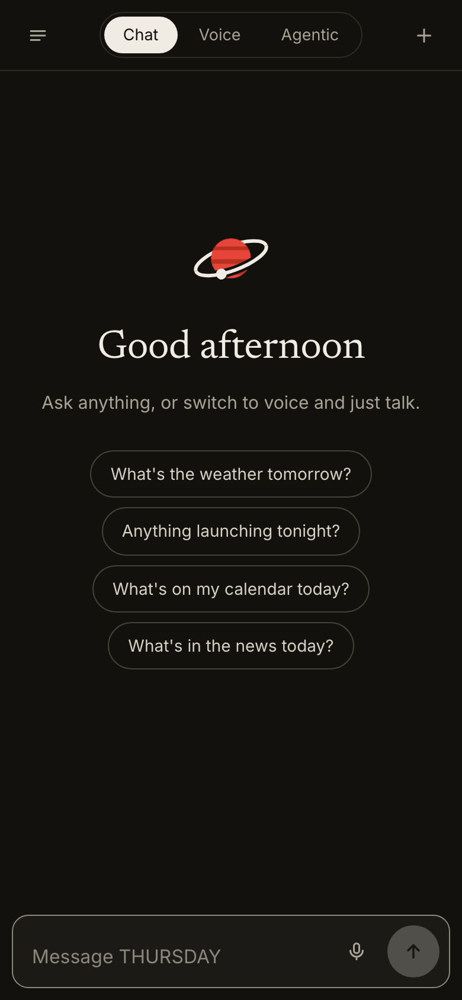
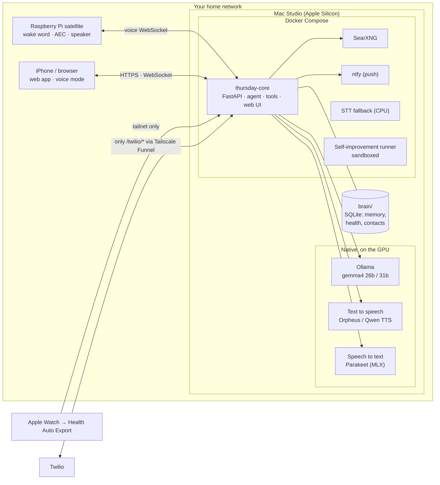

# THURSDAY

**A self-hosted, voice-first personal AI assistant that runs on your own Mac.**
You talk, it answers in about a second, and the conversation flows: a local take on ChatGPT voice mode, with
real tools (calendar, web, alarms, music, lights, phone calls, your Apple Watch data) and nothing leaving the house
except web searches.

<p align="center">
  
  
</p>

## What it does

- **Voice, everywhere.** A Raspberry Pi satellite with a "Hey THURSDAY" wake word, and voice mode in the web app
  and on your phone. Streaming end to end (LLM tokens → sentences → speech), interruptible mid-sentence, with echo
  cancellation, natural "mm-hm" backchannels and fresh spoken greetings instead of a beep.
- **Fast.** Time to first audio is the main metric: about 1 s on the satellite. Every turn's timing is logged and
  charted on the System page.
- **Tools.** Weather, web search (your own SearXNG), Apple Calendar (with confirm-before-change), alarms with a
  spoken briefing, lists and notes, YouTube Music, LIFX lights, sports and rocket launches.
- **Missions.** Longer research jobs run in the background on a bigger model and report back by voice or push.
- **Phone calls.** "Call Mom and tell her I'm running late." Two-way calls over Twilio: THURSDAY talks to the
  other person toward a goal, leaves a voicemail if nobody answers, and reports back. Heavily fenced in (below).
- **Health coach.** Your Apple Watch data (sleep stages, HRV, resting heart rate, workouts) flows in via Health
  Auto Export; the Health page shows today against your own 7-day baseline.
- **Knows you, and shows you what it knows.** Facts and conversation memories you can view, edit and delete;
  custom instructions it always follows; voice ID on the satellite so guests can't reach your calendar or calls.
- **A ChatGPT-grade web app.** Streaming Markdown, edit and resend, regenerate, read aloud, search and pinned
  conversations, AI titles, light and dark themes, and installable on your iPhone's home screen.
- **Improves itself (with your approval).** A sandboxed runner proposes code changes; nothing merges until you say so.

## Architecture



The models run **natively** on macOS so they get the Apple GPU (Docker on a Mac has no GPU access); everything else
runs in Docker Compose. The core is one FastAPI app: the agent loop (`agent_stream.py`), the voice pipeline
(`voice_ws.py`), tools, and the single-page web app (`static/index.html`).

## Quick start (Apple Silicon Mac)

You need Docker Desktop, [Ollama](https://ollama.com) and Python 3.12 (`brew install python@3.12`).

```bash
git clone https://github.com/daniel52510/thursday && cd thursday
make setup      # .env with fresh secrets, vault key, model, native STT, containers
```

Then set your password and open the app:

```bash
docker exec -it thursday-core python accounts.py passwd <your username>
open http://localhost:8000
```

Text to speech: `scripts/run_tts_native.sh` serves Qwen TTS on :9000 (or point `THURSDAY_TTS_PORT` at your own
voice server). Every setting is explained in [`.env.example`](.env.example).

**Optional extras**

| | How |
|---|---|
| Satellite (Pi Zero 2 W + mic HAT) | setup notes at the top of `satellite/satellite.py`; deploy with `make sat-deploy`, add its token in Settings → Devices |
| Phone away from home | [Tailscale](https://tailscale.com) on the Mac and phone; open the tailnet address |
| Install as an app | open it in Safari on your iPhone → Share → Add to Home Screen |
| Apple Health | Health Auto Export → REST API automation → `https://<your-mac>.<tailnet>.ts.net/api/health/ingest`, header `Authorization: Bearer <device token>` |
| Phone calls | Twilio keys in `.env`, then `tailscale funnel --bg --https=8443 --set-path=/twilio http://127.0.0.1:8000/twilio` |

## Everyday commands

```bash
make up         # build and start
make test       # the test suite (sandboxed, no network)
make logs       # follow the core log
make down       # stop (your data in brain/ stays)
```

## Security

Built for **one household on a trusted network**: the web app has logins but is meant for your LAN and tailnet,
never the open internet. The only public surface is `/twilio/*`, every request to it signed by Twilio. Phone calls
are limited to contacts you add yourself, need your spoken "yes", are capped at 10 a day and 3 minutes each, and
run with no tools and nothing about you beyond the message. Details in **[SECURITY.md](SECURITY.md)**.

## Project layout

```
agent_stream.py   the agent: prompts, tool calls, guards, streaming
voice_ws.py       voice pipeline: VAD, STT, streaming TTS, barge-in
telephony.py      Twilio calls (two-way via Media Streams)
health.py         Apple Health ingest and daily rollups
missions.py       background research jobs
static/           the web app (one file) and its service worker
satellite/        the Raspberry Pi client
scripts/          setup, deploy, tests, icon and sound generators
tests/            pytest suite (make test)
```

Design notes live in [DESIGN.md](DESIGN.md); [CLAUDE.md](CLAUDE.md) holds the working rules and latency budget.
